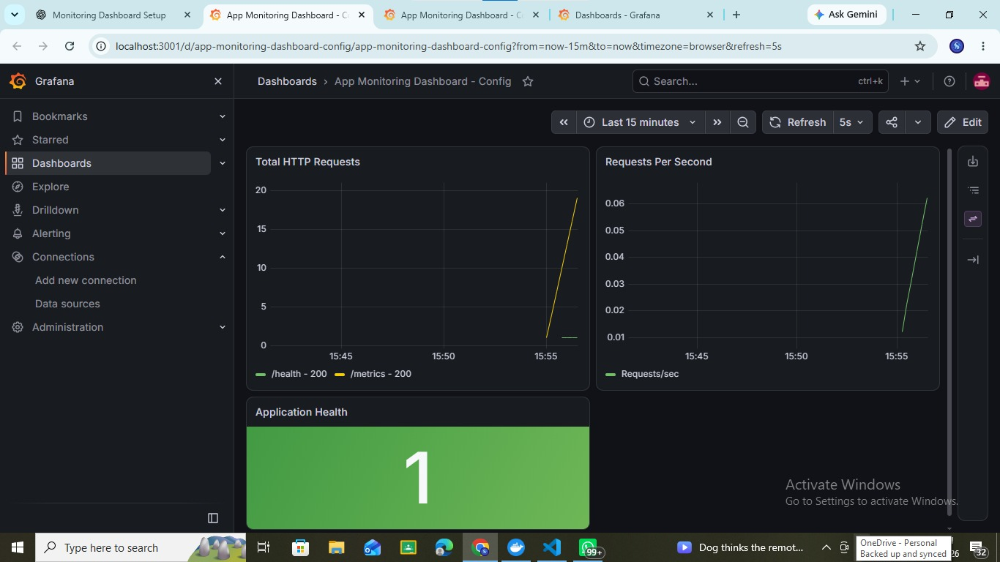

# App Monitoring Dashboard

## Project Overview
This project monitors a Node.js application using Prometheus and Grafana. It collects application metrics and displays them in a monitoring dashboard.

## Dashboard Screenshot

## Technologies Used
- Node.js and Express
- Prometheus
- Grafana
- Docker and Docker Compose

## Features
- Application health monitoring
- HTTP request counting
- HTTP request duration metrics
- Prometheus metrics collection
- Grafana dashboard visualization

## Project Setup

1. Install dependencies:
   `npm install`

2. Start the Node.js application:
   `npm start`

3. Start Prometheus and Grafana:
   `docker compose up -d`

## Service URLs
- Application: http://localhost:3000
- Health Check: http://localhost:3000/health
- Metrics: http://localhost:3000/metrics
- Prometheus: http://localhost:9090
- Grafana: http://localhost:3001

## Monitoring Metrics
- `http_requests_total` - Total HTTP requests.
- `http_request_duration_seconds` - HTTP request duration.
- `up` - Target monitoring status in Prometheus.

## Conclusion
This project demonstrates application monitoring using Node.js, Prometheus, Grafana, and Docker Compose.
